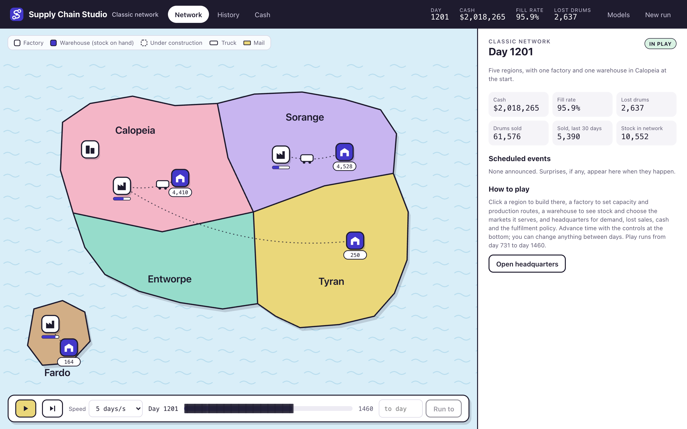
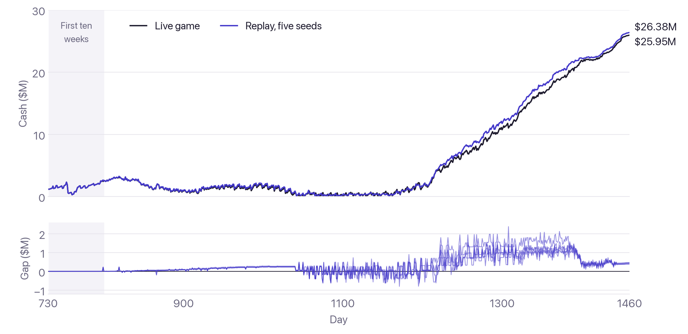
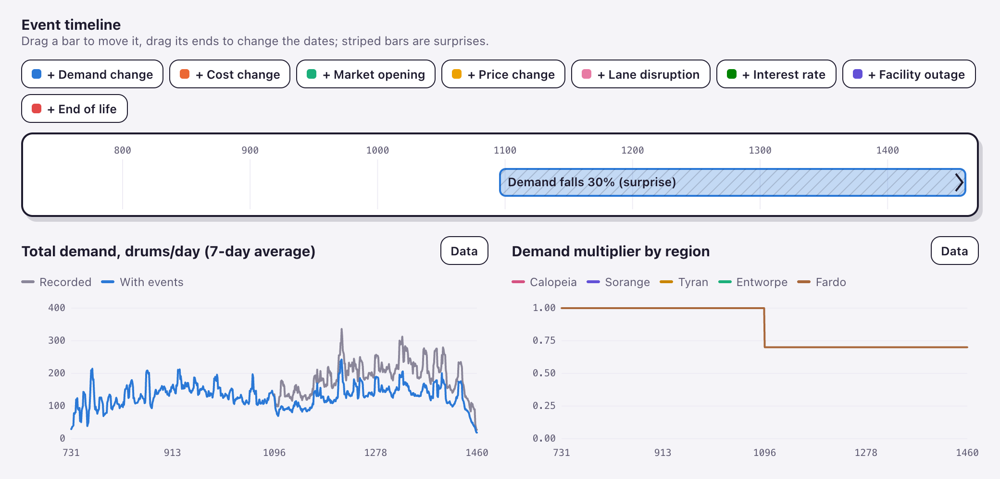
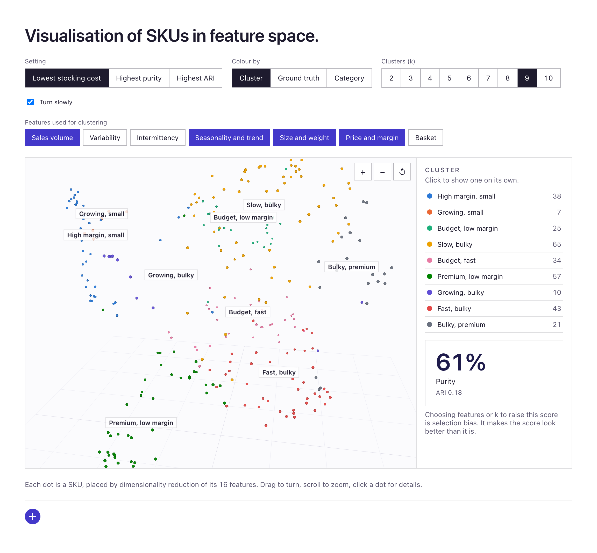
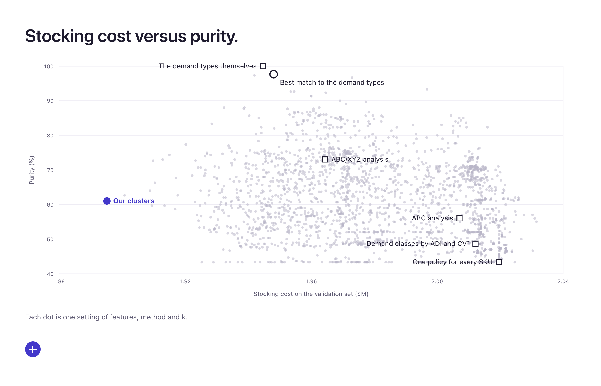
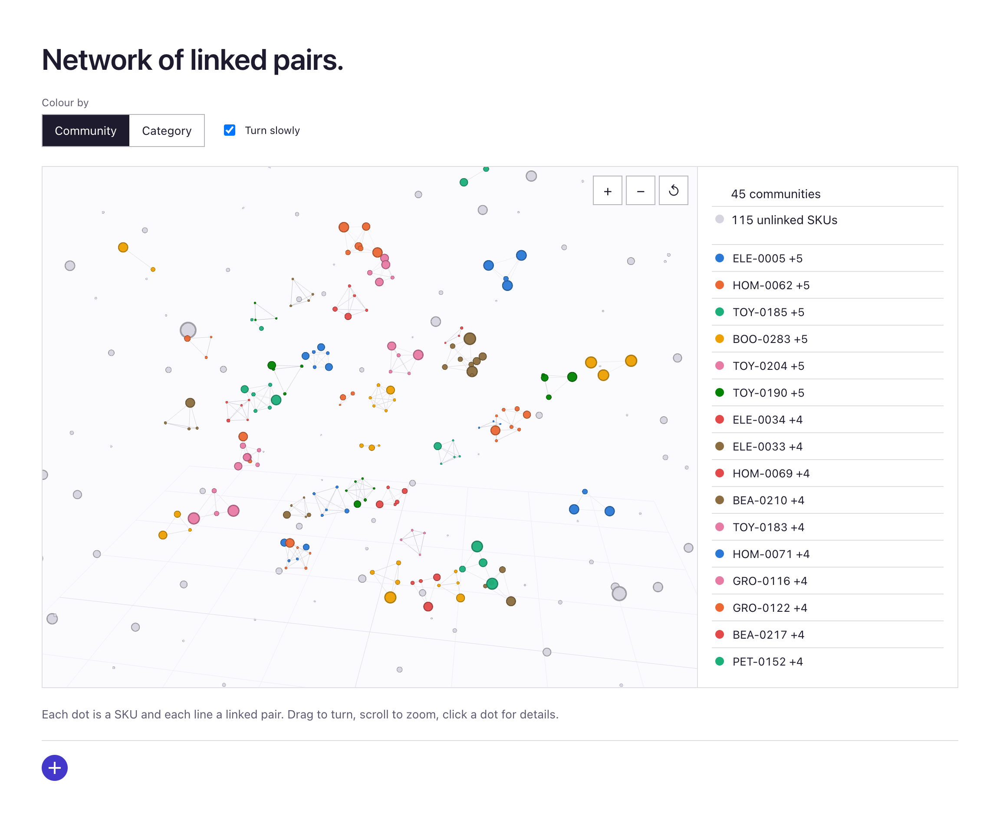
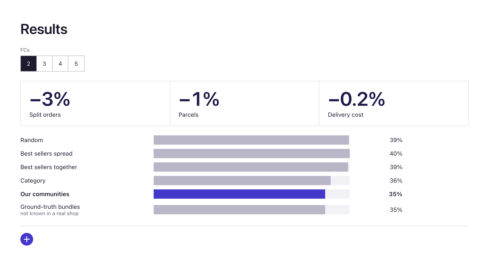
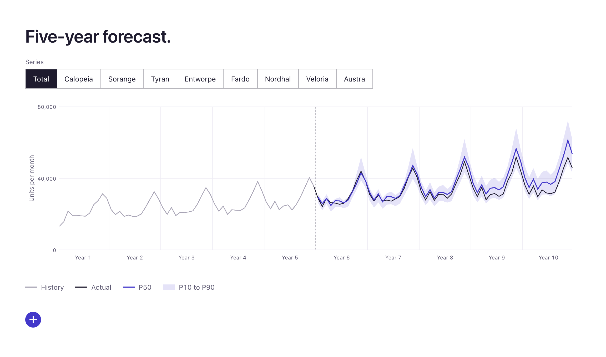
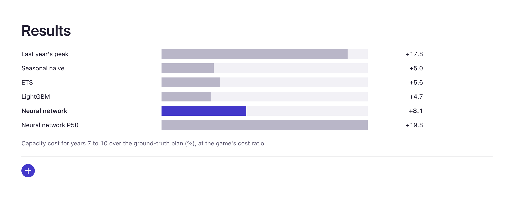

# Supply Chain Studio

[](https://www.python.org/downloads/)
[](./backend/tests)

A discrete-event simulator of a multi-region supply network, with machine learning and operations
research models for the long-term decisions a network planner faces. Replaying all 1,770
decisions of a real run of the classroom game behind its rules, the simulator ends 1.6% from the
live final cash of $25.95M.

The simulator runs a producer's factories and warehouses across five regions, day by day, and a
scenario designer sets every cost, lead time and event. The models take on questions the game cannot ask with its single product, such as which SKUs to stock
alike, which to store together and how much each region will sell over five years.

The models run on a generated online shop whose hidden structure is known, so each one is scored
against the ground truth as well as against the simple rules a planner would otherwise use.
Settings are chosen on a validation set and results come from a held-out test set.



---

## Contents

- [Simulator](#simulator)
  - [Replay of the live game](#replay-of-the-live-game)
  - [Scenario designer](#scenario-designer)
- [Models](#models)
  - [Product clustering](#product-clustering)
  - [Bought together](#bought-together)
  - [Demand five years out](#demand-five-years-out)
- [Roadmap](#roadmap)
- [Quick start](#quick-start)
- [Layout](#layout)
- [About](#about)

---

## Simulator

Two years of play across five regions, simulated day by day. Players set factory capacity, which
factory supplies which warehouse, order points and quantities, truck or mail, which warehouse
serves each market and the fulfilment policy, and try to finish with the most cash. The engine is
new code, an event-driven simulation in Python behind a FastAPI service and a React front end.

### Replay of the live game

The rules follow The Supply Chain Game, a classroom simulation by Responsive Learning
Technologies. My team won its network round during my MSc (first of ten teams, 96.88% fill rate),
and the game's log of our decisions became the test. Replayed at their exact times on the real
demand, every decision is accepted.

The game does not export when orders arrive within a day, so five random seeds stand in for it.
Cash stays within $6k of the live game on 69 of the first 70 days. Batches and large orders that
land a day early or late compound in the second year, when the paths drift up to $2.4M apart, and
the run ends 1.6% from the live result.



```bash
cd backend && uv run python verification/run3_history_replay.py
```

### Scenario designer

Nine standard scenarios range from the classic network to a demand shock, a factory fire and a
storm that cuts off the island. The designer edits costs, prices and lead times and places events
on a timeline, announced in advance or as surprises. Below is the demand shock, a surprise 30%
fall in every region from day 1,096.



## Models

The shop has 300 SKUs in eight categories and 30,000 customers in eight regions, with five years
of orders (ten for the forecast). Its hidden structure includes each SKU's demand type and the
bundles customers buy together.

### Product clustering

Which SKUs sell alike, so each cluster can get its own stocking policy? k-means and Gaussian
mixtures group the SKUs on up to 16 features of demand, size, price and basket. Picked with the
ground truth in hand, the best setting reaches 98% purity against the hidden demand types, so the
features can separate them.



The setting chosen by stocking cost on the validation year (chart below) is nine k-means clusters
with only 61% purity. On the test year it costs $2.03M, against $2.14M for ABC/XYZ analysis and
$2.19M for one policy for every SKU.



### Bought together

Which SKUs are bought together, so they should be stored in the same fulfilment centre (FC)? Each
pair's co-occurrences are compared with chance within the same region, basket size and quarter. A
Poisson test with false discovery rate control keeps the linked pairs, and Louvain community
detection groups them into 45 communities that match all 45 bundles planted in the shop. The
quarter was added after a check against the ground truth, and without it 43 of the 45 match.



With the SKUs split over two FCs and each community kept in one, 34.7% of test-year orders are
split between FCs, against 35.8% when SKUs are stored by category and 39.4% at random. Most
baskets mix unrelated items, which caps the gain.



### Demand five years out

How much will each region and category sell over five years, and how sure are we? Seasonal naive,
ETS, LightGBM and a small neural network forecast every level from the total down to each SKU in
each region, with bands from 1,000 sample paths that add up across levels.



At the total the learned models are the most accurate for three years, after which ETS, which
damps growth, is closer. Used to size capacity for years 7 to 10, LightGBM costs 4.7% more than a
plan built from the ground truth, seasonal naive 5.0%, ETS 5.6% and the neural network, chosen on
the validation years, 8.1%. Building last year's peak again costs 17.8%, and the network's median
alone, without its band, 19.8%.

The test years shown are a second draw of years 6 to 10 under the same rules. On the first, where
growth stopped altogether, last year's peak was the cheapest plan. The page discloses that draw
and every change made after test scores were seen.



## Roadmap

- **Demand in a new region** (model built, page next). A regression on region traits for markets
  with no history.
- **Risk of split orders** (model built, page next). A calibrated gradient-boosted classifier for
  orders and SKUs under a planned network.
- **Network plan** (model built, page next). A multi-period mixed-integer programme for where to
  open or expand FCs over five years.
- **Instant what-if** (planned). A surrogate of the simulator that answers in milliseconds.

## Quick start

Requires [uv](https://docs.astral.sh/uv/) and Node.js.

```bash
git clone https://github.com/Kilian-S/supply-chain-studio.git
cd supply-chain-studio
./dev.sh            # API on :8000, web app on http://localhost:5173, Ctrl+C stops both
```

Model outputs are committed in `data/models/`, so every page works from a plain checkout. To
rebuild a model, generate the shop first (about three seconds, identical every time). On macOS,
LightGBM also needs `brew install libomp`.

```bash
cd backend
uv run python -m scgame.world.generator ../data/world_v1 7
uv run python -m scgame.ml.sku_segmentation ../data/world_v1 ../data/models/sku-segmentation
```

The 228 Python tests cover every engine rule, the API, the replay of the live game and each model.

```bash
(cd backend && uv run pytest && uv run ruff check src)
(cd frontend && npx tsc --noEmit -p tsconfig.app.json && npx eslint src/models && npx vitest run)
```

## Layout

| Path | Contents |
|---|---|
| `backend/src/scgame/` | Engine, scenarios, demand, history import and the FastAPI app |
| `backend/src/scgame/world/` | Generator of the simulated shop |
| `backend/src/scgame/ml/` | The models and the simulations that price their decisions |
| `backend/verification/` | Replays of the live game and the cash chart above |
| `frontend/` | React and TypeScript app with the simulator, designer and model pages |
| `scenarios/` | Standard scenarios as JSON, plus the recorded demand |
| `data/models/` | Model outputs read by the pages |
| `docs/` | Plan, roadmap, and the design notes and reviews behind each page |
| `reference/` | Game mechanics notes and exports from the live run |

## About

Kilian Xhen Schwarz, MSc Transport, Imperial College London. Code and further work at
[github.com/Kilian-S](https://github.com/Kilian-S).
