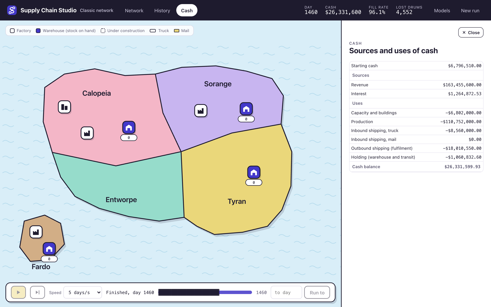
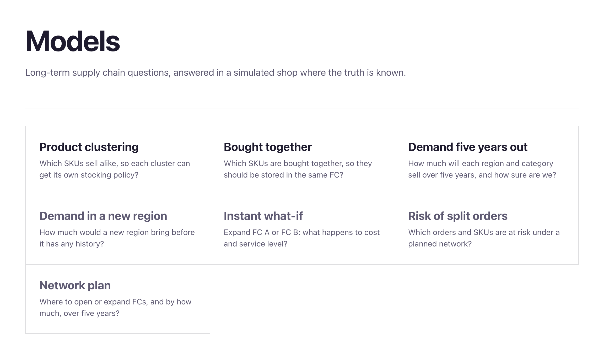

# Supply Chain Studio

Supply Chain Studio is a discrete-event simulator of a multi-region supply network, with a set of
machine learning and operations research models for the long-term questions a network planner
faces. The simulator runs a chemical producer's factories and warehouses across five regions, day
by day, and every cost, lead time and event is a scenario parameter. It has been checked against a
real run. Replaying all 1,770 decisions my team made in a live game, the simulated cash stays
within $1k of the live game on almost every day of the first ten weeks and finishes 1.6% from the
live result of $25.95M.


## Status

**Done**

- Simulator and scenario designer, checked against a real run
- Product clustering (SKU segmentation)
- Bought together (product affinity)
- Demand five years out (probabilistic hierarchical forecasting)

**In progress**

- Demand in a new region, risk of split orders and a five-year network plan. The models are built
  and their outputs committed, and their pages come next.

**Planned**

- Instant what-if, a surrogate of the simulator

## The simulator

A run covers two years of play after two years of recorded history. Each region has its own
demand, and orders arrive one at a time through the day. The player decides factory capacity,
which factory supplies which warehouse, the order point and order quantity on every route, truck
or mail, which warehouse serves each market and the fulfilment policy that picks the warehouse
for each order. Capacity takes 90 days to come online and can never be reduced, holding costs
accrue in transit as well as in the warehouse, and cash earns interest daily. The aim is the most
cash at the end.

The engine is written from scratch in Python as an event-driven simulation behind a FastAPI
service, with a React and TypeScript front end. Every rule of the game has its own test.

## Checked against a real run

The network rules follow The Supply Chain Game, a classroom simulation published by Responsive
Learning Technologies, which I played with my team during my MSc. That gave the project something
most simulators lack, a real run to check against. We won the network round (first of ten teams,
96.88% fill rate), largely with a bot we wrote to play the live game around the clock, and the
game's history page records every decision we made.

The replay applies those decisions at their exact times on the real demand, and every one is
accepted. The run ends at $26.38M against $25.95M live, averaged over five seeds. What remains
comes from order timing within a day, which the live game does not export, so the odd batch shifts by a day and the
two paths drift apart towards the end.



```bash
cd backend && uv run python verification/run3_history_replay.py
```

## Scenarios and the designer

Nine standard scenarios ship with the app, from the classic network to a sudden demand shock, a
factory fire, a storm that cuts the island off for 60 days and a product that becomes obsolete
early. The designer edits any of them or starts a new one. Prices, costs, lead times and interest
are plain fields, and events sit on a timeline as bars you drag, each either announced in advance
or a surprise. The demand, cost and interest charts redraw as you edit, so a scenario can be read
before it is played.


## Models

The classroom game has one product, so it cannot ask the questions that matter most for a network
plan. The studio therefore generates its own world, a simulated online shop with 300 SKUs in eight
categories, 30,000 customers in eight regions and five years of orders, about 450,000 baskets and
a million order lines. The shop has hidden structure that I control, such as a demand type for
every SKU and bundles of products bought together. Every model can then be scored against the
ground truth as well as against the simple rules a planner would otherwise use.

Each model has its own page, written as a short story that opens with the question, walks through
the data and the method, and ends on the results. Methods and definitions sit in drawers behind a
plus icon, so the surface stays readable. Every setting is chosen on a validation set, the results
come from a held-out test set, and any choice the ground truth informed is disclosed on the page.



### Product clustering

Which SKUs sell alike, so each cluster can get its own stocking policy? Every SKU is described by
16 features covering sales volume, variability, intermittency, seasonality and trend, size and
weight, price and margin, and basket. Clustering methods, feature sets and k are compared on the
validation year by the cost of the stocking policies each clustering leads to, and k-means with
nine clusters wins. Each cluster is named only by traits most of its members share, and a test
checks every name.


On the test year, nine cluster policies cost $2.03M, against $2.14M for ABC/XYZ analysis and
$2.19M for one policy for every SKU, and they come within 1.5% of tuning all 300 SKUs one by one.
They are even cheaper than grouping by the true demand types ($2.07M), although their purity
against those types is only 61%. The trade-off chart shows why. The grouping that is cheapest to
stock is not the one that best recovers the hidden types.


### Bought together

Which SKUs are bought together, so they should be stored in the same FC? Raw co-occurrence counts
mostly find best sellers that share a basket by chance. Each pair's count is therefore compared
with the count chance predicts within the same region, basket size and quarter, which gives its
lift. A Poisson test with false discovery rate control keeps only the pairs linked beyond chance,
and Louvain community detection turns the linked pairs into 45 communities.


The communities recover all 45 bundles planted in the shop exactly. Stored together in two FCs,
under the same SKU and workload limits for every rule, they split 34.7% of test-year orders,
against 35.8% when SKUs are stored by category and 39.4% at random. The gain is modest because
most baskets mix unrelated items, and a simulated shop's bundles are cleaner than a real shop's
would be.


### Demand five years out

How much will each region and category sell over five years, and how sure are we? Four methods
forecast every level of the hierarchy, from the total down to each SKU in each region. They are
seasonal naive, ETS, LightGBM and a small neural network, the last two trained on all series at
once. Bands come from 1,000 joint sample paths built from out-of-sample errors, and reconciliation
makes every level add up. The neural network won on validation and was refitted on years 1 to 5
to forecast years 6 to 10.


At the total the learned models are the most accurate for the first three years. After that ETS,
which damps growth, is closer, because the slowdown in the test years is not visible in the
history. Turned into capacity decisions, LightGBM gives the cheapest plan, 4.7% above a plan built
from the ground truth. The chosen network comes in at 8.1%, and rebuilding last year's peak at
17.8%. The ranking depends on the test years, and the page says so. On an earlier draw, where
growth stopped altogether, last year's peak was the cheapest.


## Roadmap

Three more models are built, with their outputs committed, and their pages are next.

- **Demand in a new region.** How much would a new region sell before it has any history? A
  regression on region traits, trained on the regions that already trade.
- **Risk of split orders.** Which orders and SKUs are likely to ship in more than one parcel under
  a planned network? A gradient-boosted classifier with calibrated probabilities.
- **Network plan.** Where to open or expand FCs, and by how much, over five years? A multi-period
  mixed-integer programme over demand scenarios drawn from the forecast.
- **Instant what-if** (planned). Expand FC A or FC B, and what happens to cost and service? A
  surrogate model trained on simulator runs, so the answer takes milliseconds rather than a full
  simulation.

## Quick start

Requirements are [uv](https://docs.astral.sh/uv/) and Node.js.

```bash
git clone https://github.com/Kilian-S/supply-chain-studio.git
cd supply-chain-studio
cd backend && uv sync && cd ..
./dev.sh            # API on :8000, web app on http://localhost:5173, Ctrl+C stops both
```

Model outputs are committed in `data/models/`, so every page works from a plain checkout. To
rebuild a model, generate the simulated shop first (about three seconds, identical every time).
On macOS the forecasting models also need `brew install libomp` for LightGBM.

```bash
cd backend
uv run python -m scgame.world.generator ../data/world_v1 7
uv run python -m scgame.ml.sku_segmentation ../data/world_v1 ../data/models/sku-segmentation
```

## Verification

```bash
(cd backend && uv run pytest && uv run ruff check src)
(cd frontend && npx tsc --noEmit -p tsconfig.app.json && npx eslint src/models && npx vitest run)
```

- 228 Python tests, covering every engine rule, the API, the replay of the real run and each model.
- Every visible string on the model pages lives in one file per page and is checked by a wording
  test.

## Layout

| Path | Contents |
|---|---|
| `backend/src/scgame/` | Engine, scenario schema, demand, history import and the FastAPI app |
| `backend/src/scgame/world/` | Generator of the simulated shop and its future years |
| `backend/src/scgame/ml/` | The models and the simulations that price their decisions |
| `backend/tests/` | Engine, API and model tests |
| `backend/verification/` | Replays of the real run and of our bot |
| `frontend/` | React and TypeScript app with the simulator, designer and model pages |
| `scenarios/` | Standard scenarios as JSON, plus the recorded demand |
| `data/models/` | Model outputs read by the pages |
| `design/` | Storylines, reviews and handovers behind each model page |
| `reference/` | Notes on the game mechanics and exports from the live run |

## About

Kilian Xhen Schwarz, MSc Transport, Imperial College London. Code and further work at
[github.com/Kilian-S](https://github.com/Kilian-S).
